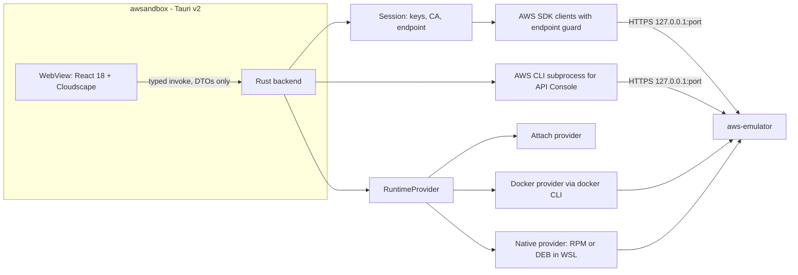

# awsandbox - source code

Everything under "Planned" is design, not implemented code. "Vendor topology" describes the pinned submodule as inspected.

## Planned architecture



- Keys and CA stay in `Session`; the WebView receives DTOs only (ASB-D17 in `awsandbox.hallucination.md`).
- The WebView never opens an emulator URL; downloads and presigned URLs go through the backend.

## Planned repository layout

| Path | Role |
|---|---|
| `src/shell/` | TopNavigation, AppLayout, services menu, unified settings, LOCAL badge |
| `src/patterns/` | Page patterns ported from cloudscape-demos |
| `src/services/<svc>/pages/` | Console-parity pages; routes mirror console URLs |
| `src/capability/` | Generated `capability.json` and `useCapability` |
| `src/bindings.ts` | Generated by tauri-specta |
| `src-tauri/src/runtime/` | `docker.rs`, `native.rs`, `attach.rs` |
| `src-tauri/src/session.rs` | Endpoint, keys, CA |
| `src-tauri/src/aws/<svc>.rs` | Tauri commands per service |
| `src-tauri/src/cli_console.rs` | AWS CLI subprocess |
| `src-tauri/src/errors.rs` | 501 to `Unsupported`, AWS error mapping |
| `tools/capability-gen/` | Builds `capability.json` from vendor |
| `tools/vendor-drift/` | Compares two vendor commits |
| `machines/_default.toml` | Default toolchain profile; others gitignored |
| `scripts/` | `dev.ps1`, `build.ps1` |
| `vendor/` | `aws-emulator`, `cloudscape-demos` submodules |

## Planned capability.json shape

```json
{
  "vendor": { "repo": "aws/aws-emulator", "commit": "a978cc2cde36", "tag": "v1.0.382", "scoredAt": "2026-11-14T16:25:52Z" },
  "ops": {
    "lambda:UpdateFunctionCode": { "tier": "green", "pass": "9/10", "unsupported": ["PublishTo"] }
  }
}
```

## Page pattern sources

| Console page kind | cloudscape-demos page |
|---|---|
| Resource list | `table-property-filter`, `server-side-table-property-filter` |
| Details with tabs | `details-tabs` |
| Details hub | `details-hub` |
| Single-page create | `form`, `form-validation`, `form-unsaved-changes` |
| Multi-step create | `wizard` |
| Edit | `edit` |
| Delete confirmation | `delete-with-simple-confirmation`, `delete-with-additional-confirmation` |
| Tags | `manage-tags` |
| S3 location pickers | `read-from-s3`, `write-to-s3` |
| Service dashboard | `dashboard` |
| Console Home | `configurable-dashboard` |
| Version comparison | `split-panel-comparison` |
| Log events | `table-date-filter` |
| Inline item edit | `table-editable` |

## Vendor topology

**Vendor:** aws-emulator@a978cc2cde36 (v1.0.382)

| Path in `vendor/aws-emulator` | Use for awsandbox |
|---|---|
| `services/service-<name>/smithy-model/*.json` | Operation list, shapes, API Console forms |
| `services/service-<name>/src/ops/<op>.rs` | `not_implemented("...")` variant messages |
| `services/service-<name>/src/ops/SKIPPED_STUBS.md` | Operations with no handler at all |
| `services/service-<name>/src/scaffolded.rs` | The 501 channel (`Scaffolded::not_implemented`) |
| `issues/things-that-do-not-work/`, `issues/things-that-now-work/` | Drift signal |
| `core/router/src/main.rs`, `vendor/server/src/cli.rs` | CLI flags, ports, admin route |
| `core/embedded/src/lib.rs` | Embedded mode API for Phase 9 |

- Service folders are named `service-com-amazonaws-<namespace>-<shape>`, for example `service-com-amazonaws-lambda-awsgirapiservice`.
- `scores.json.gz` is a release asset, not in the tree: `gh release download <tag> -R aws/aws-emulator -p scores.json.gz`. Each unit has `services`, `kind` (`wire` or `behavioral`), `outcome`, and `detail.steps[]` with `operation` and `outcome`.
- Step operations include setup calls to other services, so filter steps by the service's own model operations.
