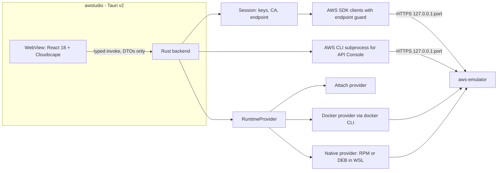

# awstudio - source code

Everything under "Planned" is design, not implemented code unless an "Implemented in Phase N" section lists it. "Vendor topology" describes the pinned submodule as inspected.

## Implemented in Phase 0

Committed in `d535a96`; verified items are in the Phase 0 checkpoint of `awstudio.roadmap.md`.

| Path | Role |
|---|---|
| `src/main.tsx`, `src/App.tsx` | React 18 entry and an empty Cloudscape `AppLayout` |
| `src-tauri/src/lib.rs` | Tauri builder; `crate-type` is `rlib` only (ASD-D20) |
| `src-tauri/src/emulator_tls.rs` | `sts_client`: empty trust store plus the emulator CA, static keys, endpoint override; removed in Phase 2, replaced by `aws.rs` |
| `src-tauri/tauri.conf.json` | Strict CSP, `bundle.active` false, dev server `127.0.0.1:1420` |
| `machines/_default.toml`, `scripts/machine.ps1` | Default profile and the loader that exports `RUSTUP_TOOLCHAIN` and `PATH` |
| `tools/vendor-drift/vendor_drift.py` | Two-commit comparison for the 11 services |
| `tools/hygiene/hygiene.py`, `.githooks/pre-commit` | Staged-text check run through `uv` |
| `.github/workflows/ci.yml` | Windows build of the scaffold, actions pinned by commit SHA |

## Implemented in Phase 1

Committed in `2fb042d` and `22ee71e`; verification is in the Phase 1 checkpoint of `awstudio.roadmap.md`.

| Path | Role |
|---|---|
| `src-tauri/src/provider/mod.rs` | `Provider` trait, `Endpoint`, `LogLine`, `ProviderError`, the pin constants and the key filename constant |
| `src-tauri/src/provider/docker.rs` | `docker` CLI driver: engine classification, path translation, Dockerfile with signature check, `docker run` arguments |
| `src-tauri/src/provider/native.rs` | `wsl.exe --exec env HOME=<windows profile> aws-emulator ...`, log hub that replays and streams |
| `src-tauri/src/provider/attach.rs` | Health only; stop, restart, version and logs are unsupported |
| `src-tauri/src/provider/health.rs` | HTTPS `GET /__admin/health` trusting only the emulator CA, on a plain OS thread |
| `src-tauri/src/provider/version.rs` | `aws-emulator -v` parser and pinned-commit comparison |
| `src-tauri/src/provider/settings.rs` | `settings.json` in the app config directory |
| `src-tauri/src/commands.rs` | Tauri commands over one locked `Runtime`; `provider_status` uses `try_lock` and reports `busy` |
| `src-tauri/tests/live_providers.rs` | Ignored live tests against a real engine and a WSL binary |
| `src/runtime/` | `api.ts` (hand-written `invoke` wrappers) and `Runtime.tsx` (status, provider settings, logs, modals) |

## Implemented in Phase 2

Committed in `80a18b6`, `5dc0e1c`, `4f12a55` and `632ca58`; verification is in the Phase 2 checkpoint of `awstudio.roadmap.md`.

| Path | Role |
|---|---|
| `src-tauri/src/session.rs` | `Session::load` from the per-port files (key, CA, region from `config`); `same_run` detects a restart; `Debug` hides the secret; `SessionInfo` is the key-free DTO |
| `src-tauri/src/aws.rs` | `Clients` (shared `SdkConfig`, CA-only TLS, explicit credentials, `sts()`, path-style `s3()`), `EndpointGuard` interceptor, `ApiError` and `map_sdk_error` (501 to `unsupported`) |
| `src-tauri/src/env.rs` | `CLEARED` variables, `variables`, PowerShell and cmd `block`, `open_terminal` (new console, argument array) |
| `src-tauri/src/commands.rs` | Adds `session_info`, `session_check`, `env_block`, `open_terminal`; `Runtime.clients` cached per run, dropped on stop and target change, preloaded after start and restart |
| `src-tauri/src/lib.rs` | `bindings()` registry shared by the app and the export; debug runs export to `src/bindings.ts` |
| `src-tauri/build.rs` | Links the Windows resource into integration test binaries (ASD-D23) |
| `src-tauri/tests/bindings.rs`, `tests/live_session.rs` | Bindings freshness check; ignored live STS, S3, restart, CLI environment and region probe |
| `src/bindings.ts` | Generated, committed; `src/runtime/api.ts` now wraps it |
| `src/runtime/SdkAccess.tsx` | Endpoint, region, files folder, "Test connection", environment tabs with copy, "Open terminal with emulator environment" |

## Implemented in Phase 3

Committed in `11a6413` to `52fe16d`, navigation guard in `8ce1a04`; verification is in the Phase 3 checkpoint of `awstudio.roadmap.md`.

| Path | Role |
|---|---|
| `tools/capability-gen/capability_gen.py` | Reads models, `@op` headers, scaffold markers, `not_implemented` messages and the tag's `scores.json.gz` (cached in `.cache/`); writes `capability.json` one operation per line |
| `src/capability/capability.json` | Generated, committed; loaded as a separate chunk |
| `src/capability/index.tsx` | `CapabilityProvider` (run-scoped 501 cache), `useCapability("svc:Op", variant?)`, `judge`, `variantUnsupported`, `reportUnsupported`, `tierCounts` |
| `src/runtime/RuntimeStatus.tsx` | App-wide status poll (2 s), `runId`, `markLifecycle`, version check once per run |
| `src/shell/` | `TopNav`, `ConsolePage` (AppLayoutToolbar per route, help, split panel slot), hash `router` (with `setNavigationGuard`, one capture `hashchange` listener registered at module load that holds a navigation for a dirty form, ASD-D25), `services` (11 services, console paths), `regions`, `preferences` (unified settings in localStorage), `notifications`, `GlobalNotices` (telemetry, version mismatch), `storage` |
| `src/patterns/` | `gating` (`UiOnlyScope`, `GatedButton`, `UnsupportedBanner`), `ResourceTable`, `DetailsPage`, `CreateForm`, `CreateWizard`, `unsaved`, `DeleteModal`, `ManageTags`, `S3Picker`, `ServiceDashboard`, `ComparisonSplitPanel`, `table-common` (date filter form) |
| `src/pages/` | `ConsoleHome` (board), `EmulatorPage`, `SettingsPage`, `ServiceLanding` (support table per service), `PatternGallery` (dev builds only) |
| `src/App.tsx` | Providers, sticky `#top-nav`, routes |

- A page whose primary List or Describe operation is red or not judged yet wraps its content in `UiOnlyScope` as UI-only; every `GatedButton` inside is disabled with the page's reason. A yellow primary read loads data under a partly supported banner (ASD-D32, `gating.tsx` row below).
- Control ids are `<service key>:<Operation>`; the service key is the SDK id slug (ASD-D26 in `awstudio.hallucination.md`).

## Implemented in Phase 4

Committed in `f737fab`, `2ff5f40`, `5bb1850` and `81673f4`, partial-read gating, S3 default encryption and the upload limit hint in `3007e58`, `d241796` and `b718f5c`; verification is in the Phase 4 checkpoint of `awstudio.roadmap.md`.

| Path | Role |
|---|---|
| `src-tauri/src/aws.rs` | `Clients::s3_in`, `dynamodb_in`, `sqs_in`, `sns_in` (a client per Region, guard attached), `is_region_code`, `ApiError::Invalid`; `map_sdk_error` takes `service:Operation` |
| `src-tauri/src/services/mod.rs` | `Tag`, `Json` (crosses IPC as TypeScript `unknown`, ASD-D30), timestamp helpers |
| `src-tauri/src/services/s3.rs` | 28 commands (`s3_get_bucket_encryption` returns none when the bucket has no configuration); `upload_file` (PutObject below 16 MiB, 8 MiB parts above, abort on failure), `download_to` (`.part` file renamed on success), native dialogs opened by the backend |
| `src-tauri/src/services/dynamodb.rs` | 17 commands; DynamoDB JSON to and from SDK attribute values |
| `src-tauri/src/services/sqs.rs`, `sns.rs` | 12 and 14 commands |
| `src-tauri/tests/live_s3_transfer.rs` | Ignored live test of a multipart upload and download, 60 MiB by default (`AWSTUDIO_TRANSFER_MIB`) |
| `src/services/common.tsx` | `useLoad` (no call on a UI-only page), `useAction`, `useGates`, `GatedDropdown`, `TagsTable`, `EditTagsModal`, `FormModal`, `JsonEditor`, formatters |
| `src/services/<svc>/<Svc>Pages.tsx` | One module per service exporting `<svc>Page(path, query)`; `SqsPages` also exports `queueUrlOfArn` and `allowTopic` |
| `src/services/routes.tsx` | `servicePage`, `hasServicePages`; `App.tsx` falls back to the support landing page for services without pages |
| `src/patterns/CreateForm.tsx` | `onSubmit` may return the route to open; one request per submit (ASD-D29) |
| `src/patterns/gating.tsx` | `usePageCapability` sets `uiOnly` for a red or unjudged primary read and `partial` for a yellow one (ASD-D32); `UiOnlyScope` provides both with `primaryOp`; `useGate` enables `primaryOp` on a partial scope and leaves every other control to its own tier; `ScopeBanner` renders `UnsupportedBanner` or `PartialBanner`, used by `CreateForm`, `DetailsPage`, `ServiceDashboard` and the service sections |

Routes (hash paths mirroring console paths):

| Service | Routes |
|---|---|
| S3 | `/s3/buckets`, `/s3/bucket/create`, `/s3/buckets/<name>?tab=&prefix=`, `/s3/object/<bucket>?prefix=<key>&versionId=` |
| DynamoDB | `/dynamodbv2/{dashboard,tables,create-table,backups,partiql-editor}`, `/dynamodbv2/tables/<name>`, `/dynamodbv2/item-explorer?table=`, `/dynamodbv2/{create-item,edit-item}?table=&key=` |
| SQS | `/sqs/queues`, `/sqs/queues/create`, `/sqs/queues/<url>`, `/sqs/queues/<url>/{edit,send-receive}` |
| SNS | `/sns/{dashboard,topics,create-topic,subscriptions,create-subscription}`, `/sns/topic/<arn>`, `/sns/publish/<arn>`, `/sns/subscription/<arn>` |

## Implemented in Phase 5

Committed in `32cc89a` (commands) and `a241ecd` (pages); verification is in the Phase 5 checkpoint of `awstudio.roadmap.md`.

| Path | Role |
|---|---|
| `src-tauri/src/aws.rs` | `Clients::lambda_in` (a client per Region), `iam` (session Region, IAM is global), `fetch` (download of an emulator URL: CA-only trust, endpoint guard on the URL, no redirect, size cap) |
| `src-tauri/src/services/iam.rs` | 41 commands; `PrincipalKind` and `TaggableKind` share the attach, detach, inline policy and tag commands; `decode_document` undoes URL-encoding; user, group and role deletes clean up first; `NewAccessKey` has no `Debug` |
| `src-tauri/src/services/lambda.rs` | 20 commands; `read_zip` and `write_zip` (files with no text keep their bytes), `package_of` (GetFunction `Code.Location` through `Clients::fetch`), `wait_ready` (ASD-D33), `lambda_invoke` with the decoded log tail |
| `src/services/iam/IamPages.tsx` | `iamPage(path)`: dashboard, users, groups, roles, policies; `Permissions` (shared by user, group and role), `PolicyPicker`, create wizards for users and roles, access keys tab |
| `src/services/lambda/LambdaPages.tsx` | `lambdaPage(path)`: dashboard, functions, create form, details with `CodeTab`, `TestTab` (events in localStorage `awstudio.lambda.events.<name>`), configuration sections, `AliasesTab`, `VersionsTab` |

Routes:

| Service | Routes |
|---|---|
| IAM | `/iam/dashboard`, `/iam/{users,groups,roles,policies}`, `/iam/{users,groups,roles,policies}/create`, `/iam/users/<name>?tab=`, `/iam/groups/<name>?tab=`, `/iam/roles/<name>?tab=`, `/iam/policies/<arn>?tab=` (the ARN is URL-encoded) |
| Lambda | `/lambda/dashboard`, `/lambda/functions`, `/lambda/functions/create`, `/lambda/functions/<name>?tab=code\|test\|configuration\|aliases\|versions` |

## Planned architecture



- Keys and CA stay in `Session`; the WebView receives DTOs only (ASD-D17 in `awstudio.hallucination.md`).
- The WebView never opens an emulator URL; downloads and presigned URLs go through the backend.

## Planned repository layout

| Path | Role |
|---|---|
| `src/shell/` | TopNavigation, AppLayout, services menu, unified settings, LOCAL badge |
| `src/patterns/` | Page patterns ported from cloudscape-demos |
| `src/services/<svc>/pages/` | Console-parity pages; routes mirror console URLs (implemented in Phase 4 as one `<Svc>Pages.tsx` per service) |
| `src/capability/` | Generated `capability.json` and `useCapability` |
| `src/bindings.ts` | Generated by tauri-specta |
| `src-tauri/src/runtime/` | `docker.rs`, `native.rs`, `attach.rs` |
| `src-tauri/src/session.rs` | Endpoint, keys, CA (implemented in Phase 2) |
| `src-tauri/src/aws/<svc>.rs` | Tauri commands per service (implemented in Phase 4 as `src-tauri/src/services/<svc>.rs`) |
| `src-tauri/src/cli_console.rs` | AWS CLI subprocess |
| `src-tauri/src/errors.rs` | 501 to `Unsupported`, AWS error mapping (implemented in Phase 2 inside `aws.rs`) |
| `tools/capability-gen/` | Builds `capability.json` from vendor |
| `tools/vendor-drift/` | Compares two vendor commits |
| `machines/_default.toml` | Default toolchain profile; others gitignored |
| `scripts/` | `dev.ps1`, `build.ps1` |
| `vendor/` | `aws-emulator`, `cloudscape-demos` submodules |

## capability.json shape

Implemented in Phase 3; the earlier plan keyed operations flat as `lambda:UpdateFunctionCode` and listed variants as bare names.

```json
{
 "vendor": { "repo": "aws/aws-emulator", "commit": "a978cc2cde36", "tag": "v1.0.382", "scoredAt": "2026-11-14T16:25:52.650744+00:00" },
 "thresholds": { "green": ">= 80%", "yellow": "> 0%", "red": "0% or HTTP 501" },
 "services": {
  "lambda": {
   "name": "AWS Lambda", "sdkId": "Lambda", "prefix": "lambda", "models": ["service-com-amazonaws-lambda-awsgirapiservice"],
   "ops": {
    "UpdateFunctionCode": {"tier": "green", "pass": "9/10", "unsupported": ["PublishTo"]}
   }
  }
 }
}
```

- `reason` is `unwired` or `scaffolded` on an operation that always answers 501.

## Page pattern sources

| Console page kind | cloudscape-demos page |
|---|---|
| Resource list | `table-property-filter`, `server-side-table-property-filter` |
| Details with tabs | `details-tabs` |
| Details hub | `details-hub` |
| Single-page create | `form`, `form-validation`, `form-unsaved-changes` |
| Multi-step create | `wizard` |
| Edit | `edit` |
| Delete confirmation | `delete-with-simple-confirmation`, `delete-with-additional-confirmation` |
| Tags | `manage-tags` |
| S3 location pickers | `read-from-s3`, `write-to-s3` |
| Service dashboard | `dashboard` |
| Console Home | `configurable-dashboard` |
| Version comparison | `split-panel-comparison` |
| Log events | `table-date-filter` |
| Inline item edit | `table-editable` |

## Vendor topology

**Vendor:** aws-emulator@a978cc2cde36 (v1.0.382)

| Path in `vendor/aws-emulator` | Use for awstudio |
|---|---|
| `services/service-<name>/smithy-model/*.json` | Operation list, shapes, API Console forms |
| `services/service-<name>/src/ops/<op>.rs` | `not_implemented("...")` variant messages |
| `services/service-<name>/src/ops/SKIPPED_STUBS.md` | Operations with no handler at all |
| `services/service-<name>/src/scaffolded.rs` | The 501 channel (`Scaffolded::not_implemented`) |
| `issues/things-that-do-not-work/`, `issues/things-that-now-work/` | Drift signal |
| `core/router/src/main.rs`, `vendor/server/src/cli.rs` | CLI flags, ports, admin route |
| `core/embedded/src/lib.rs` | Embedded mode API for Phase 9 |

- Service folders are named `service-com-amazonaws-<namespace>-<shape>`, for example `service-com-amazonaws-lambda-awsgirapiservice`.
- `scores.json.gz` is a release asset, not in the tree: `gh release download <tag> -R aws/aws-emulator -p scores.json.gz`. Each unit has `services`, `kind` (`wire` or `behavioral`), `outcome`, and `detail.steps[]` with `operation` and `outcome`.
- Step operations include setup calls to other services, so filter steps by the service's own model operations.
